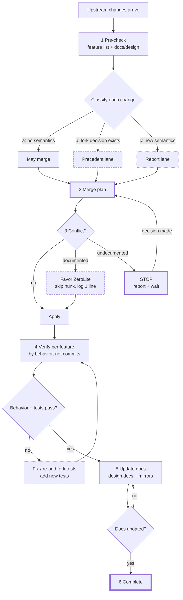

# Upstream merge update rules

The standing workflow for every upstream merge. Details live in
`zerolite_feature_list.md` and `docs/design/`; this document is the outline
the agent must not deviate from.

Kept out of `AGENTS.md` on purpose: it is read only when a merge is actually
happening, and `AGENTS.md` stays a short set of standing rules.

## Workflow

Thick solid marks a gate that waits for the user, dashed a fork decision
applied over upstream, dotted a stop or a repair loop, and heaviest the
finish.

Two gates stop the flow on their own: the plan review before any write
(§2), and an undocumented conflict (§3). Neither is a warning — the merge
does not advance until the user answers.

The loop back from §5 is the one people skip: docs are a completion
criterion, so a merge with green tests and stale docs is still open.

## 1. Pre-check

Read `zerolite_feature_list.md` and every design doc in `docs/design/`
before touching upstream code. Classify each upstream change:

- (a) no semantics touched → may merge;
- (b) covered by a recorded fork decision → precedent lane;
- (c) new semantics with no precedent → report lane.

## 2. Merge plan, then STOP

Generate the merge plan from the pre-check and present it for user review.
Do not execute until the review passes. The plan lists, per upstream change:
classification, the design-doc decision it cites (or "no precedent"),
conflicts, and the tests guarding each affected feature.

## 3. Execute

Documented conflict → favor ZeroLite: skip the conflicting upstream hunk,
keep fork behavior, log one line (commit, file, decision number, "skipped
per `<doc>` #N"). Never adapt fork code to upstream semantics; never
reintroduce an upstream knob under a fork name.

Undocumented conflict → STOP, report (commit, what the new semantics is,
what adopting or refusing it changes), and wait for a decision. Never
silently adopt upstream semantics.

## 4. Post-merge verification — per feature, by behavior

For each feature in the feature list, run its design doc's "Merge notes"
checks: the behavior exists, its tests exist and pass.

Never verify by commit count or commit presence: merge timelines are
scrambled, and a present commit does not prove a surviving behavior (the
`ContextConfig` orphan: the type parsed, its tests passed, and no runtime
code read it).

Fork tests that upstream rewrote away must be re-added. Upstream logic
changes, semantic-concept changes, and conflict resolutions each get new
tests.

Gateway-facing features (master pair code is the standing example) are
verified end to end: unit tests passing while a gateway path fails does not
close the feature.

## 5. Post-merge docs — part of the merge, not follow-up

After merge tests pass, update every design doc and the feature list touched
by a conflict, plus mirrors (`docs/book/.../context-management.md`). Record
each new decision in the design doc it belongs to; once written back, it is
precedent for the next merge.

A merge is not complete until its docs are updated.

## 6. Completion

A merge is done only when: the plan was reviewed, conflicts were handled by
lane, per-feature behavior checks pass, fork tests survive (or were
re-added), new tests were added, and docs were updated.
